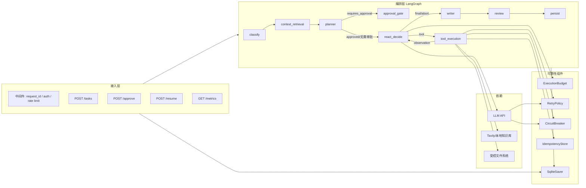
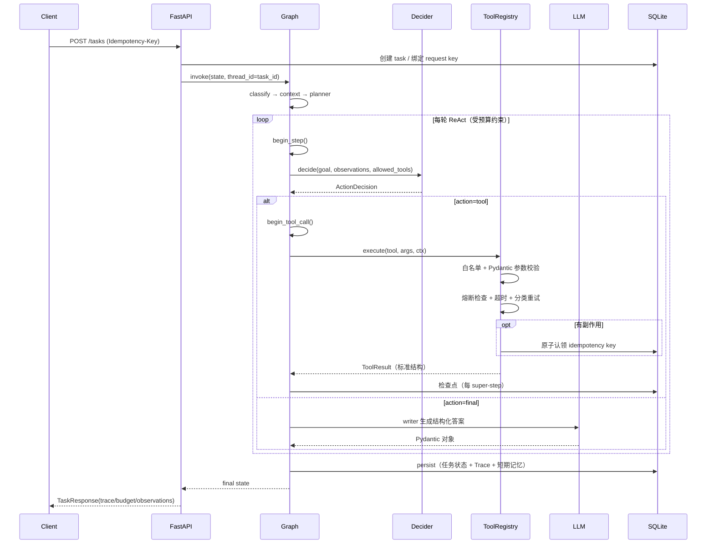
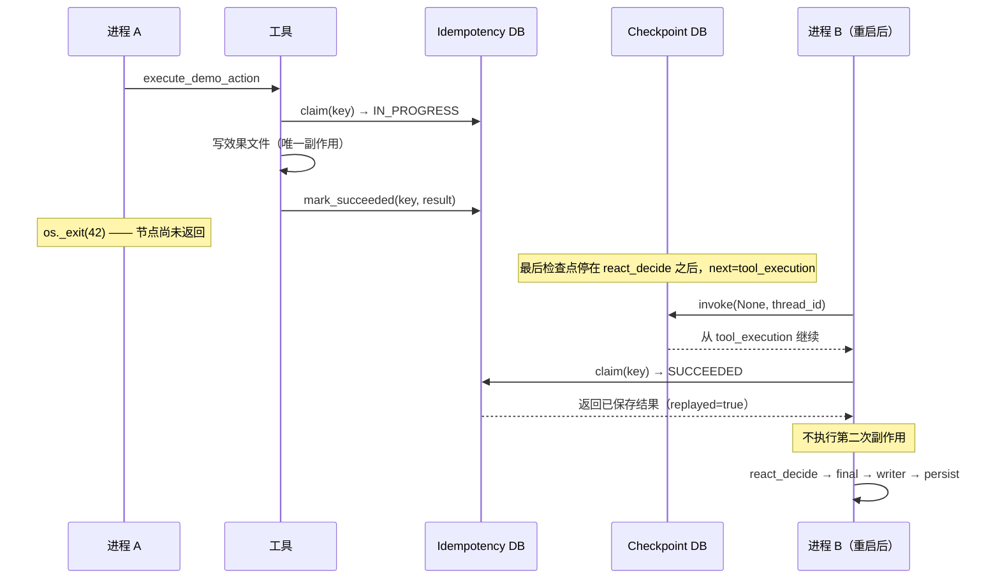
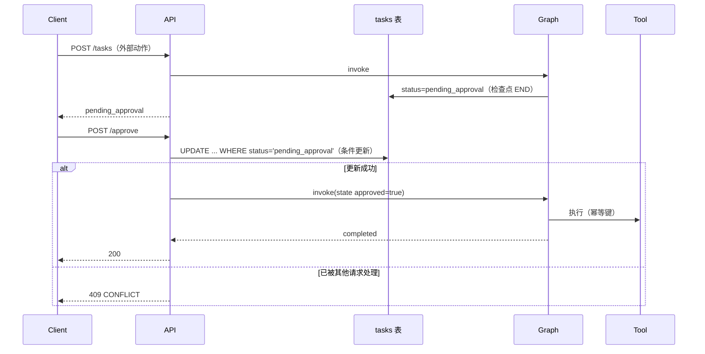
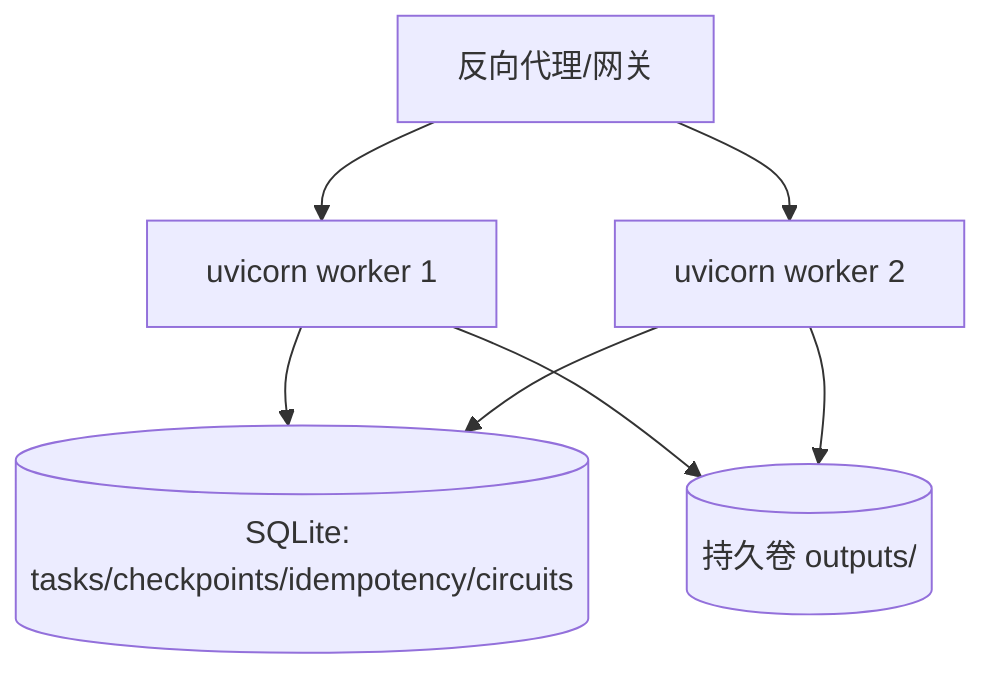

# 升级后架构说明

## 1. 分层

| 层 | 组件 | 职责 | 不负责 |
|---|---|---|---|
| 接入层 | FastAPI `app/main.py` | 认证、限流、参数校验、错误契约、请求 ID、优雅关闭 | 不做 Agent 决策 |
| 编排层 | `app/agents/agent_graph.py` | LangGraph 节点、条件边、ReAct 循环、预算扣减 | 不直接执行工具 |
| 决策层 | `app/agents/react.py` | 结构化 `ActionDecision`，Mock/LLM 两种决策器 | 不校验权限 |
| 工具层 | `app/tools/registry.py` | 白名单、参数 Schema、超时、重试、熔断、幂等、降级 | 不拼接回答 |
| 模型层 | `app/services/llm_service.py` | 模型调用、分类重试、熔断、备用模型、usage 记账 | 不决定是否调用工具 |
| 状态层 | `repository.py` / `checkpoint.py` / `idempotency.py` / `memory.py` | 任务记录、图检查点、副作用记录、记忆 | 不包含业务推理 |

依赖方向：接入 → 编排 → 决策/工具/模型 → 状态。状态层不反向依赖上层。

---

## 2. 组件图

---

## 3. 一次正常任务（数据 + 时序）

---

## 4. 崩溃恢复时序（工具成功、检查点未写）

关键点：**幂等记录必须先于检查点落库**（实际上先于副作用返回），否则崩溃窗口无法闭合。代码顺序：工具执行 → `mark_succeeded` → 节点返回 → LangGraph 写检查点。

---

## 5. 审批时序

---

## 6. 状态与数据模型

### tasks
`task_id PK, user_id, session_id, goal, task_type, status, state_json, created_at, updated_at, heartbeat_at, error_code, attempts`

`status ∈ {running, completed, partial, pending_approval, interrupted, cancelled, failed}`

### traces
`id PK, task_id, node, event_json, created_at`；事件含 `step/action/tool/ok/attempts/replayed/degraded/duration_ms/budget`。

### idempotency_records
`key PK, tool, params_hash, task_id, status, result_json, error_code, error_message, attempts, owner, lease_expires_at, created_at, updated_at, expires_at`

### memories
`id PK, user_id, session_id, kind(short_term|long_term), content, tags_json, dedupe_hash, importance, created_at, expires_at, last_used_at`，唯一键 `(user_id, kind, dedupe_hash)`。

### circuit_state
`name PK, state_json, updated_at`；`BEGIN IMMEDIATE` 读改写。

### task_requests
`request_key PK, task_id, created_at`；`Idempotency-Key` → 任务去重。

### LangGraph checkpoint
由 `SqliteSaver` 管理（`checkpoints` / `writes` 表），按 `thread_id=task_id` 隔离。

---

## 7. 错误分类到动作的映射

| 分类 | 典型来源 | 重试 | 熔断计失败 | 上层动作 |
|---|---|---|---|---|
| NETWORK | 连接重置、DNS | 是 | 是 | 有限退避 |
| TIMEOUT | 读/写超时 | 仅幂等操作 | 是 | 副作用操作标 UNKNOWN |
| RATE_LIMIT | 429 | 是（Retry-After） | 是 | 等待后重试 |
| SERVER | 5xx | 是 | 是 | 退避 |
| AUTH / PERMISSION | 401/403 | 否 | 否 | 直接失败，不切备用模型 |
| VALIDATION | 4xx/参数/Pydantic | 否 | 否 | 返回 422 |
| BUSINESS | 业务规则/审批冲突 | 否 | 否 | 409 或明确终态 |
| CIRCUIT_OPEN | 熔断器 | 否（本次） | — | 降级或 503 |
| BUDGET | 预算耗尽 | 否 | 否 | partial + stop_reason |
| UNKNOWN | 未知异常 | 否 | 是（保守） | partial / 人工介入 |

---

## 8. 部署拓扑（当前实现）

要求：
- `data/` 与 `outputs/` 必须在持久卷；
- 单机多 worker 共享 SQLite 可用（WAL + busy_timeout + 短事务），但写放大明显；
- 多主机需替换为 Postgres（任务/幂等/熔断/记忆）+ 任务租约/分布式锁；这不是当前代码已实现的能力。

---

## 9. 必须保留的代码不变量

1. 模型输出永远只是 `ActionDecision`，不能直接调用函数。
2. 工具执行必须先过 allow-list 与参数 Schema。
3. 有副作用的工具必须先认领幂等键，成功结果必须落库。
4. 预算扣减先于资源消耗；耗尽必须走明确终态。
5. 每个 super-step 必须写检查点；恢复必须复用幂等结果。
6. 降级结果必须带 `degraded` / `degrade_reason` / `limitations`。
7. Trace 写入前脱敏；日志不打印 prompt 全文与密钥。